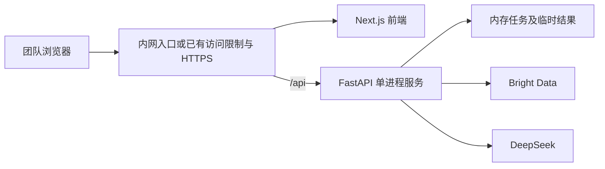

# 技术栈与部署方案

版本：MVP v0.1；日期：2026-10-21。

## 1. 总体结构

采用前后端分离：Next.js＋TypeScript 负责用户看到的网页，FastAPI＋Python 负责外部数据请求和分析。Bright Data 相当于评论供应商，DeepSeek 相当于阅读、翻译和整理评论的分析助手。

浏览器不直接调用这两个供应商。所有密钥放在后端，前端只与本项目接口通信。Next.js 不重复实现采集与分析业务，避免出现两套后端逻辑。

| 技术 | 职责 | 选择原因 |
| --- | --- | --- |
| Next.js | 页面和前端构建 | 已确认采用，可实现交互页面并独立部署 |
| TypeScript | 前端类型约束 | 减少字段拼写和接口结构不一致造成的问题 |
| FastAPI | 后端 HTTP 接口 | 适合 Python 数据处理，可自动生成接口说明 |
| Python | 采集、分析编排、统计及导出 | 便于处理文本和 Excel，逻辑集中易维护 |
| Pydantic | 数据结构校验 | 检查外部响应及 AI 输出是否符合要求 |
| HTTPX | 异步 HTTP 调用 | 直接对接 Bright Data 与兼容模型接口，控制超时 |
| openpyxl | Excel 导出 | 支持多工作表、文本格式和基础排版 |
| Uvicorn | 运行 FastAPI | 为浏览器提供持续运行的后端服务 |
| 内存任务表 | 临时任务状态和结果 | 首版无历史要求，避免引入数据库 |

这些是待实现的依赖选择，不表示已经安装。具体版本在开发时选择兼容稳定版本并锁定，本次不虚构版本号。

## 2. 为什么保留异步任务，但不使用队列

评论采集可能需要等待第三方任务完成，AI 翻译和归纳也可能持续较长时间。如果浏览器一直等待一个长请求，容易遇到超时，而且无法了解当前阶段。

因此提交接口立即返回一个随机任务 ID，后端在同一服务进程内继续执行，浏览器定时查询进度。这叫异步处理，不等于建立任务排队系统。

首版建议最多同时执行一个分析任务。已有任务运行时，新请求立即返回“服务忙”，不等待、不排队。并发上限属于工程建议，可以后续调整。浏览器应提示正在执行的任务不会因关闭页面而自动取消。

不用 Celery、Redis、数据库或复杂消息系统。代价是重启会丢失任务，不能承诺后台任务永久可靠执行。

## 3. Bright Data 接入

使用专门的 Amazon Reviews 数据采集接口，不将控制台用户设置页面当作 API 地址。实际接入需要后端 API Key、正确的采集器或 Dataset ID，以及账号当前提供的输入字段定义。

优先直接 HTTP 调用，流程按实际服务能力采用“触发采集—查询状态—下载结果”。精确路径和参数必须以实际接口文档及账号生成示例为准，不能猜测 `pastDays=0` 就是不限时间，也不能凭参数名字认定限制有效。

官方产品页列有 ASIN、评论正文、星级、日期、商品名、评论 URL 等字段，但不意味着每条记录都完整返回。[Bright Data Amazon Reviews](https://brightdata.com/products/web-scraper/amazon/reviews)

官方 SDK 仓库有数量和时间参数未传递的缺陷报告，故需检查真实请求及结果，而不是仅检查函数参数是否填写。[SDK Issue #62](https://github.com/brightdata/sdk-python/issues/62)

先完成以下验证：最新评论排序、无日期限制、最多 100 条采集限制、父子范围、完整原文。不能先收集全部评论再静默丢弃大部分，声称已经遵守“最多采集 100 条”。

## 4. DeepSeek 接入

首版按兼容 OpenAI 的 Chat Completions 协议调用。官方 Base URL 为 `https://api.deepseek.com`，模型名由服务端配置，不依赖固定旧别名。更换服务时，必须确认协议、鉴权和 JSON 输出能力兼容，不能认为任意地址与 Key 都能直接使用。[DeepSeek 接入说明](https://api-docs.deepseek.com/)

首版不引入向量数据库、RAG 平台或多智能体框架：一个 ASIN 最多 100 条评论，可以分批处理并统一汇总。AI 返回结构化 JSON，Pydantic 检查字段，后端验证引用和计算数字。

JSON Output 仍可能返回空结果或截断，因此设置合理输出预算、按长度分批并有限重试。[DeepSeek JSON Output](https://api-docs.deepseek.com/guides/json_mode/)

## 5. 推荐部署

建议使用同一域名，页面路径交给前端，`/api` 转发给 FastAPI。这样浏览器配置简单；如果前后端分域，则明确设置允许的来源，不使用任意来源通配。

部署形态可以是同一台服务器的两个常驻服务。前端也可在满足构建约束时静态部署；首版不依赖 Next.js 服务端渲染功能。最终方式在开发时按服务器环境确定。[Next.js 部署文档](https://nextjs.org/docs/app/getting-started/deploying)

后端只启动一个 worker、一个实例。进程内存不天然跨进程共享，多 worker 会导致查询不到在另一进程创建的任务。后续扩容前应先把任务状态迁移到共享存储。[FastAPI worker 文档](https://fastapi.tiangolo.com/deployment/server-workers/)

## 6. 配置建议

| 配置 | 用途 | 默认建议 |
| --- | --- | --- |
| `BRIGHT_DATA_API_KEY` | 供应商鉴权 | 必填，保密 |
| `BRIGHT_DATA_DATASET_ID` | 评论采集器标识 | 按账号实际值 |
| `LLM_BASE_URL` | 模型服务地址 | DeepSeek 官方或兼容地址 |
| `LLM_MODEL` | 模型名称 | 必填，按实际可用值 |
| `LLM_API_KEY` | 模型密钥 | 必填，保密 |
| `MAX_REVIEWS` | 单次评论上限 | 100 |
| `RESULT_TTL_SECONDS` | 完成结果保留时长 | 7200，待按使用情况调整 |
| `MAX_ACTIVE_ANALYSES` | 同时运行任务数 | 1，无队列 |

还需要外部请求超时、整个任务超时、轮询间隔等设置。它们是工程参数，不需要暴露给普通用户。密钥不能使用会被打包到浏览器的前端公开变量。

## 7. 数据与运行限制

- 无数据库：没有历史列表，重启后无法恢复结果。
- 建议完成后保留 2 小时，页面显示过期时间，提醒及时导出；过期返回明确提示。
- 日志仅记任务阶段、错误码、耗时和数量，不记录密钥和整批评论原文。
- 输入仅接受 ASIN，后端构造固定美国站 URL；不允许浏览器提供任意抓取地址或模型地址。
- 前端将原文作为普通文本显示，导出 Excel 时禁用公式解释。
- 不收集 Amazon 账号、密码或 Cookie；不将评论者姓名、主页等无关字段发送给模型。

## 8. 使用权边界

Bright Data 是第三方采集服务，不是 Amazon 官方授权评论 API 的同义词。供应商可提供数据不等于本产品自动获得所有再使用权。内部分析、原文导出和向模型传输的具体许可需核对所适用的合同及条款。[Bright Data 协议](https://brightdata.com/license)

Amazon Customer Feedback API 面向有相应权限的卖家或供应商，提供主题与趋势洞察，并非可直接假定返回任意竞品最新 100 条完整原文的替代入口。[Amazon Customer Feedback API](https://developer-docs.amazon/sp-api/lang-en_US/docs/customer-feedback-api)

以上为架构边界说明，不作接口能力或法律结论的提前保证。
