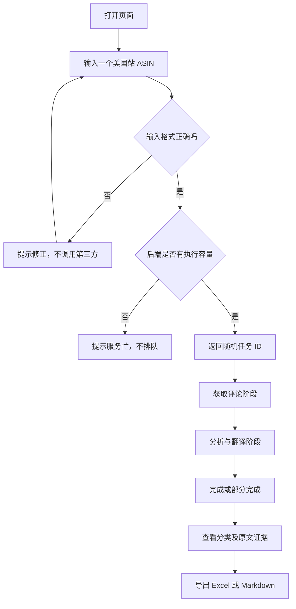
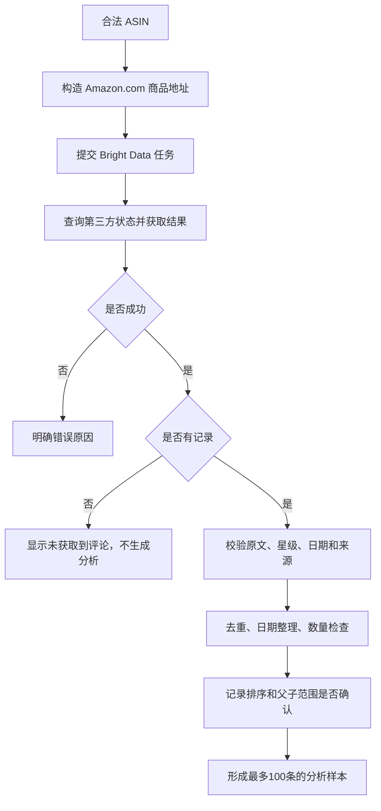
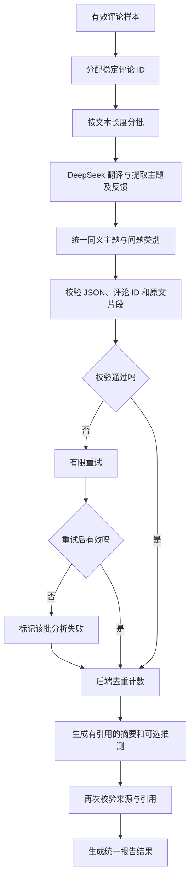
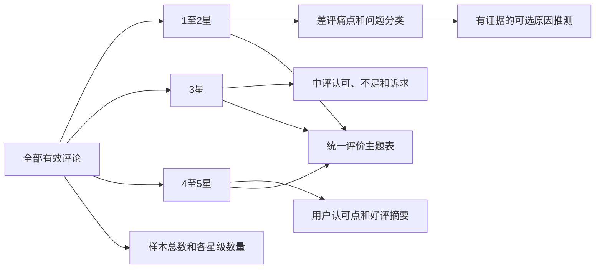
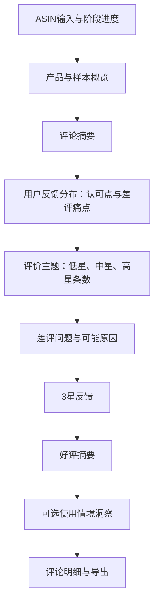
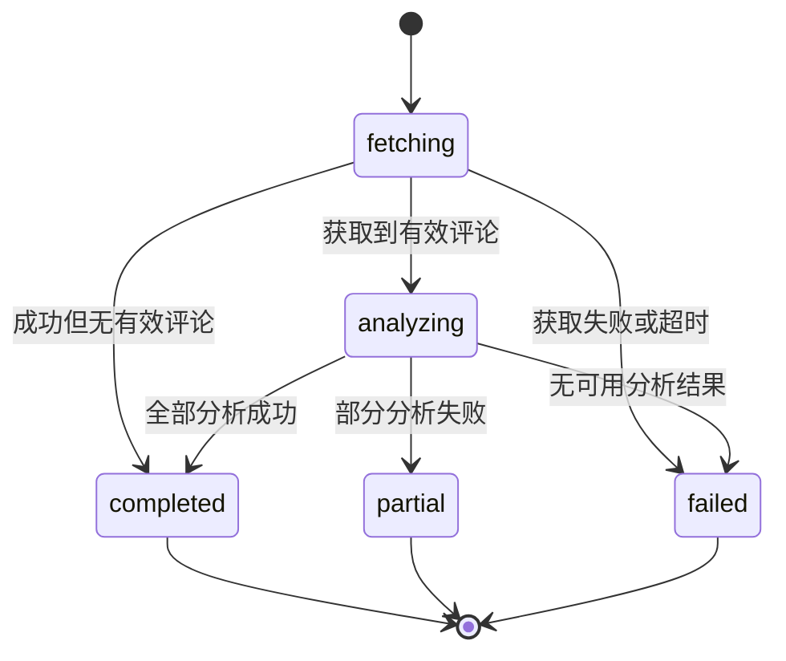

# 逻辑图与流程说明

版本：MVP v0.1；日期：2026-10-21。

## 1. 用户完整流程

进度只表示真实阶段，不显示伪造的 30%、80% 等数字。没有队列并不代表没有异步任务，后台仍需等待第三方采集和模型分析。

## 2. 数据采集与范围校验

供应商端数量限制是采集目标，本地数量检查是防御措施，后者不能代替前者。若供应商意外返回超过上限的数据，最多分析 100 条并记录超限，不继续补采或宣称采集上限验证通过。

范围校验不能只比较请求 ASIN 与记录 ASIN。需要依据供应商字段、接口定义及实际页面，识别是否存在共享评论。父子关系无法确认时保留未知，避免人为制造精确性。

## 3. AI 分析与程序统计

AI 负责读懂语言，程序负责可靠计算。例如模型识别某几条评论涉及耐用性，程序根据不同评论 ID 计算“6 条”，而不是让模型直接估计数字。

若部分评论分析失败，采集样本的星级统计仍可按有效原始数据计算；但分类与摘要必须显示实际已分析数量和缺失，不把未分析记录理解成没有问题。

## 4. 星级如何参与不同板块

星级只是分组规则，不能替代文本理解。5 星评论可能提到不足，1 星评论也可能认可某个功能。全星级主题表可以保留这种复杂性，但好评摘要和差评统计不能跨越已经确定的星级边界。

## 5. 页面信息层级

点击任何反馈或主题，均可打开其关联评论列表。证据列表显示原文和中文翻译，并带星级、日期、ASIN；原始链接存在时提供跳转。

## 6. 任务状态

`completed` 且评论为零是可解释的空结果，不是“0% 差评”。`partial` 表示结果有缺失，可查看并导出，但必须携带缺失说明。到期清理或服务重启后，查询返回“任务已过期或不可用”。

## 7. 异常对照表

| 情况 | 用户看到什么 | 系统不能做什么 |
| --- | --- | --- |
| 无效 ASIN | 输入格式错误 | 调用外部服务浪费请求 |
| 后端忙 | 请稍后重试 | 暗中创建排队任务 |
| API Key 失效 | 数据服务配置异常 | 显示当前没有差评 |
| 采集成功但为空 | 当前未获取到评论 | 编造产品洞察 |
| 有评论、无低星 | 当前最新样本暂无差评 | 强行生成差评分类 |
| 仅1条低星 | 展示问题与单条证据提示 | 断言普遍性故障 |
| 子商品范围不明 | 评论范围未确认 | 标为子商品专属评论 |
| 排序未保证 | 最新覆盖未确认 | 用本地排序冒充最新采集 |
| 模型部分失败 | 已分析数量及缺失提示 | 显示完整分析成功 |
| 临时结果过期 | 结果不可用，请重新分析 | 承诺历史恢复 |

## 8. 导出路径

页面和两种导出都读取同一份后端报告对象，不重新调用模型。这样可以防止页面写“6 条”，导出却写“8 条”。每份报告记录生成时间、模型名、分析规则版本、采集范围和限制，便于人工解释结果。
